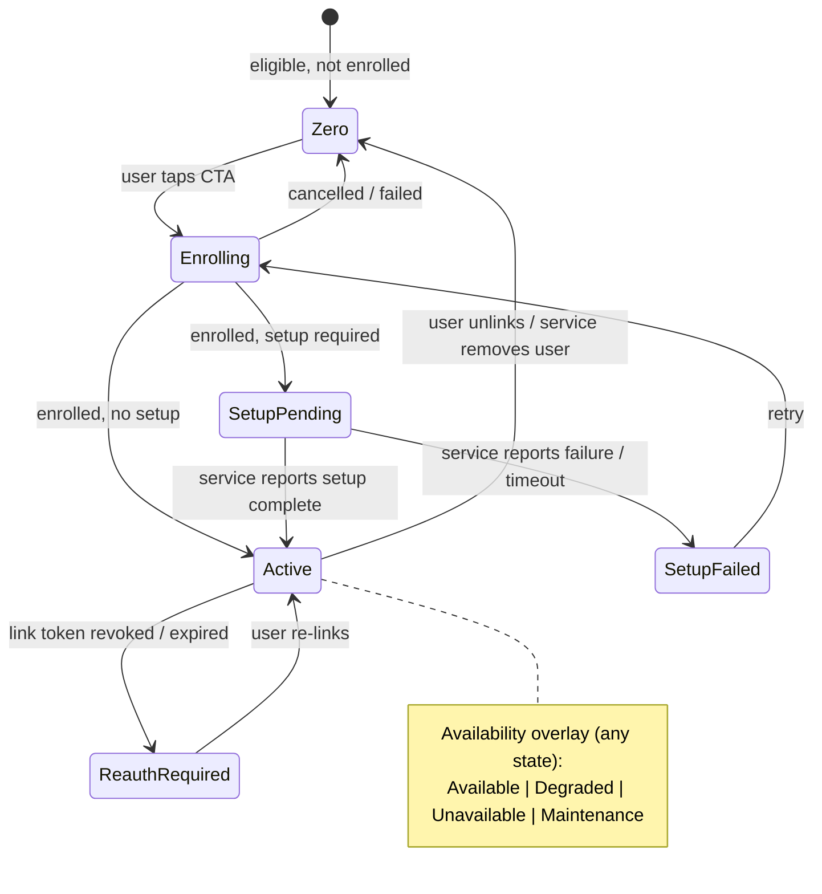

# 01 — Mobile App (iOS / Android)

Back to [README](README.md). The terms used here are defined in the README's glossary.

---

## BR-01 — White-label app per tenant (flavoring) · MVP

**Why:** We sell the same product to many customers. Each customer must look like it has its own app.

- **US-01.1** As a tenant, I want my own app name, icon, splash screen and store listing, so that users recognise my brand.
- **US-01.2** As a tenant, I want colours, fonts and imagery to follow my brand, so that the app feels like mine.
- **US-01.3** As the platform team, I want to create a new flavor from configuration only, so that onboarding a customer costs no development.

**Acceptance criteria**
- **AC-01.1.1** A new flavor can be produced from one config file plus a tenant ID, with no source-code changes. The config covers bundle/application ID, display name, icons, splash, signing identity and the default locale.
- **AC-01.2.1** Theme tokens (primary/secondary/surface colours, typography, corner radius, dark-mode variants) are loaded from tenant config *at runtime*. Changes published in the portal appear on the next app launch, without a store release.
- **AC-01.2.2** If remote config can't be fetched, the app starts with the last cached config. If there is no cache, it uses the config bundled at build time. The app never shows unbranded or blank screens.
- **AC-01.3.1** Two flavors installed on the same device are fully isolated: separate storage, keychain/keystore entries, push tokens and sessions.

---

## BR-02 — Single sign-in through the primary service (OAuth 2.1) · MVP

**Why:** The primary service owns the customer relationship and identity. Everything else hangs off that login.

- **US-02.1** As a user, I want to sign in with my existing primary-service account, so that I don't create yet another account.
- **US-02.2** As a user, I want to stay signed in between app launches, so that I'm not asked to sign in repeatedly.
- **US-02.3** As a user, I want biometric unlock (optional), so that re-entry is fast but still secure.

**Acceptance criteria**
- **AC-02.1.1** Login uses OAuth 2.1 Authorization Code + PKCE. The flow runs in the **system browser** (ASWebAuthenticationSession / Android Custom Tabs), never in an embedded webview, per RFC 8252.
- **AC-02.1.2** Given a first-time user, when login succeeds, then the user lands on the services home within 2 s of the redirect (p90), and a platform user record is created and linked to the primary identity (`sub`).
- **AC-02.1.3** Given login is cancelled or fails, then the user returns to the welcome screen with a human-readable message and a retry action. Raw error codes are never shown.
- **AC-02.2.1** Refresh tokens are kept only in secure storage (Keychain / Android Keystore-backed) and are rotated on every use. Sessions last `N` days of inactivity, where `N` is configurable per tenant.
- **AC-02.2.2** Given the refresh token is revoked or expired, when the app next calls the backend, then the user is sent to login, and after re-login returns to the screen they were on.
- **AC-02.3.1** Biometric unlock is opt-in, can be turned off in settings, and falls back to device passcode or full login. Whether it is available is a per-tenant setting.

---

## BR-03 — Tabbed services home · MVP

**Why:** One place to see and move between everything the club offers.

- **US-03.1** As a user, I want to see all the services available to me as tabs I can swipe between, so that I can browse them quickly.
- **US-03.2** As a user, I want the order and visibility of tabs to make sense for me, so that I'm not shown things I can't use.

**Acceptance criteria**
- **AC-03.1.1** Tabs are rendered from the tenant's published config: order, icon, title and colour accent. The primary service may have its own tab; this is configurable.
- **AC-03.1.2** Users can switch tabs by swipe gesture and by tapping the tab bar. Transitions run at 60 fps on reference devices (see NFR-02).
- **AC-03.1.3** On launch, the home shows cached tab content immediately (skeletons where there's no cache) and refreshes in the background. The user never waits on a blank screen.
- **AC-03.2.1** Services can be targeted by eligibility rules (e.g. user segment or region, supplied as claims from the primary). An ineligible service is not shown at all.
- **AC-03.2.2** The last selected tab is restored on the next launch, unless a notification or deep link targets a different tab.
- **AC-03.2.3** A tab shows an unread badge when the service has unread in-app notifications for the user (see BR-09).

---

## BR-04 — Service tab states · MVP

**Why:** The tab must always tell the user exactly where they stand with each service, and what to do next.

### State model (source of truth)

Two state dimensions apply to every tab:

1. **Enrollment state:** what the user's relationship with the service is.
2. **Availability:** whether the service is reachable right now. This is an *overlay* on top of the enrollment state, not a peer state. When the service recovers, the tab returns to the correct enrollment state.

You listed four states. The diagram adds **Enrolling**, **SetupFailed** and **ReauthRequired**. Real integrations hit all three, and without them users get stuck.

- **US-04.1** As a user, I want each tab to show the state that matches my real status, so that I know what to do.
- **US-04.2** As a user, I want to be told clearly when a service is down, and when it will be back if known.

**Acceptance criteria**
- **AC-04.1.1** **Zero state** shows the content configured for the service in the portal: hero image/video, title, description, benefit bullets, CTA label, and optional legal/terms links.
- **AC-04.1.2** **Setup pending** shows the configured message, an optional estimated time, and a progress illustration. It does not offer to open the service unless the owner has enabled "allow access during setup".
- **AC-04.1.3** Given a tab is in Setup pending, when the service reports completion (BR-42), then the tab moves to Active within 5 s if the app is open (real-time), or on the next foreground otherwise. The user also gets a push, if they have opted in.
- **AC-04.1.4** Given setup has not completed within the configured timeout, then the tab shows SetupFailed with support contact info and a retry action.
- **AC-04.1.5** **Re-auth required** explains that the connection expired and offers one-tap re-linking. Cached preview data is not shown.
- **AC-04.2.1** **Unavailable / Maintenance** overlay shows the owner-supplied message and the expected recovery time when known. The CTA to open the service is disabled. Preview data, if cached, is shown dimmed with a "last updated" time.
- **AC-04.2.2** The overlay is triggered by *either* a status the service declares (Partner API or portal) *or* a status the platform detects (BR-25 / BR-46). When the platform detects a problem, the user-facing text stays generic and never blames the partner.
- **AC-04.2.3** Every state has a defined loading, empty and error presentation. No tab ever shows a raw webview error page.

---

## BR-05 — Enrolling in a service · MVP (one mode), Next (others)

**Why:** Enrollment is the conversion funnel for every partner. Friction here directly costs partner revenue.

**Recommendation.** "Is setup also OAuth?" depends on who owns the user's account at that service. Support three
**enrollment modes**, chosen per service in the portal:

| Mode | When to use | How it works |
|---|---|---|
| **A. Federated (SSO)** *(MVP default)* | The service accepts the tenant's identity. Typical for the primary's own services | We call the service's enrollment endpoint server-to-server with a pairwise user ID and the consented claims. The service creates the account. The user experience is one tap plus a consent sheet |
| **B. Account linking (OAuth 2.1)** | The service has its own accounts and login (e.g. an existing bank or wallet) | The app opens the service's OAuth authorization page in the system browser. The user signs in or registers there and consents. Our backend stores the tokens and uses them for previews |
| **C. Web onboarding** | The service needs a long KYC or form flow it already built | We open the service's onboarding page in the web container with a handoff code. The service calls our Partner API when the user is enrolled |

- **US-05.1** As a user, I want to join a service in as few steps as possible, so that I'm not put off.
- **US-05.2** As a user, I want to see and approve what personal data is shared with the service, so that I stay in control.

**Acceptance criteria**
- **AC-05.1.1** Mode A: given the user taps the CTA, then a native consent sheet lists the data fields to be shared (configured per service) and the service's terms. On approval, the enrollment completes, or moves to Setup pending, without the user leaving the app.
- **AC-05.1.2** Mode B: the flow runs in the system browser with PKCE, and the app regains focus automatically on redirect. Tokens are never stored on the device; they are held by the backend.
- **AC-05.1.3** Mode C: given the service calls `enrollment.completed` for the user, then the tab state changes as in AC-04.1.3. If the user abandons the flow, the tab stays in Zero.
- **AC-05.1.4** Enrollment is idempotent. Retrying or double-tapping never creates duplicate enrollments.
- **AC-05.2.1** Consent is recorded with timestamp, field list, terms version and app version, and can be viewed and revoked in profile (BR-10).
- **AC-05.2.2** Each service receives a **pairwise** user identifier, so two services cannot correlate users by ID unless the tenant explicitly configures a shared ID.

---

## BR-06 — Preview cards · MVP

**Why:** Showing value (balance, points, next booking) without a tap is what makes the home feel alive and brings users back.

**Recommendation.** Render previews **natively from structured data** using a small library of templates, rather than embedding a mini webview per tab. Native rendering is what makes the experience smooth.

- **US-06.1** As an enrolled user, I want to see my key information from each service on its tab, so that I don't need to open it.
- **US-06.2** As a user, I want preview data to feel current, so that I trust it.

**Acceptance criteria**
- **AC-06.1.1** The platform offers at least these preview templates: *Balance/Metric* (value, unit, delta), *List* (up to 5 rows), *Progress* (e.g. points to the next tier), *Card* (title, subtitle, image, badge) and *Actions* (up to 3 quick-action deep links). The service owner picks a template in the portal.
- **AC-06.1.2** The BFF calls the service's preview endpoint (defined in BR-40) server-to-server, with the pairwise user ID and a signed request. The app never calls services directly for previews.
- **AC-06.1.3** Preview responses are validated against the template schema. An invalid response shows the tab's fallback content ("Open {service}") and raises an alert for the owner.
- **AC-06.2.1** Previews use stale-while-revalidate. Cached data shows instantly with a "last updated" label when it is older than the configured freshness. A refresh happens on tab focus and on pull-to-refresh.
- **AC-06.2.2** The preview call has a hard timeout (default 1.5 s, configurable up to 3 s). After a timeout, the tab shows cached or fallback content and never a spinner forever.
- **AC-06.2.3** A service can push a preview update via the Partner API (e.g. after a payment). When the app is open, it appears within 5 s.
- **AC-06.2.4** Sensitive values (e.g. balance) can be marked "masked by default". The user taps to reveal them, and they are hidden again on app background.

---

## BR-07 — Opening a service (handoff + web container) · MVP

**Why:** The service must open already signed in. Being asked to log in again breaks the super-app promise.

**Recommendation.** Make the handoff an **OIDC-shaped authorization code exchange**: a one-time code is put in the URL and redeemed server-to-server. Services can then use off-the-shelf OIDC libraries instead of a custom protocol.

- **US-07.1** As a user, when I tap "Open" on a service, I want to land inside it already signed in.
- **US-07.2** As a user, I want the service to feel like part of the app, not like a browser.

**Acceptance criteria**
- **AC-07.1.1** Given the user taps Open, then the backend issues a handoff code that is opaque, at least 128-bit, single-use, valid for 60 s or less, and bound to user + service + device. The web container loads `launchUrl?code=…&state=…`, or the deep-link target URL when one applies.
- **AC-07.1.2** The service redeems the code at the Handoff endpoint using its client credentials and receives the pairwise user ID, the consented claims and a session hint. A code that is reused, expired or redeemed by the wrong client is rejected and the attempt is logged.
- **AC-07.1.3** No access token, refresh token or primary-IdP credential ever appears in a URL, the webview's local storage, or the logs.
- **AC-07.1.4** Time from tap to first meaningful paint of the service is 2.5 s or less at p75 on 4G. The web container shows a branded loading transition, never a white flash.
- **AC-07.2.1** The web container provides: the top bar with a home button (BR-08), a progress indicator, pull-to-refresh (configurable per service), Android back that navigates webview history before exiting, and an iOS swipe-back gesture.
- **AC-07.2.2** Navigation outside the service's allow-listed domains opens in the system browser. File downloads, `tel:`, `mailto:` and app links are handled natively.
- **AC-07.2.3** Camera, location and file upload are permitted only when enabled for the service in the portal, and they trigger the OS permission prompts.
- **AC-07.2.4** Given the service's web session expires while it is open, when the service calls the bridge `requestReauth`, then a fresh handoff happens silently, with no login screen.

---

## BR-08 — Navigation: side menu, home button, deep links · MVP

- **US-08.1** As a user, I want a side menu with shortcuts to specific pages across services, so that I can jump straight to what I need.
- **US-08.2** As a user inside a service, I want one tap to get back to my services home.
- **US-08.3** As a user, I want links in notifications, emails and other services to take me to the right place in the app.

**Acceptance criteria**
- **AC-08.1.1** On the home screen the top bar shows a hamburger icon. Tapping it opens a side drawer with the menu configured in the portal: sections, items, icons and ordering.
- **AC-08.1.2** Each menu item targets either a native screen (profile, inbox, settings) or a **service deep link** (service + path).
- **AC-08.1.3** Given a menu item targets a service the user is enrolled in, then the service opens at that path via handoff (AC-07.1.1). Given the user is *not* enrolled, then the user is taken to that service's Zero-state tab, with the deep link kept so it opens after enrollment.
- **AC-08.1.4** Menu items can be hidden depending on enrollment state and eligibility. For example, "My cards" appears only when the user is enrolled in Wallet.
- **AC-08.2.1** While a service is open, the hamburger icon animates into a home icon. Tapping it returns to the tabbed home on the tab for that service, with a matching reverse transition.
- **AC-08.2.2** Returning home keeps the service's web session alive for a configurable period, so re-opening is instant.
- **AC-08.3.1** The app supports Universal Links / App Links with the format `https://{tenant-domain}/s/{serviceKey}/{path}`. A link opens the right tab or service, and if the user is signed out it resumes after login.
- **AC-08.3.2** A hosted service can open another service via the bridge (`openService(serviceKey, path)`) only if both services are placed in the same tenant.

---

## BR-09 — Notifications (push + in-app) · MVP

**Recommendation.** Use a **push model**. Services call our Notification API whenever they want to reach a user. Do not poll services. This keeps us the single owner of push tokens, user preferences, rate limits and the inbox, and makes delivery real-time. See BR-42 for the API.

- **US-09.1** As a user, I want push notifications from the services I use, so that I don't miss anything important.
- **US-09.2** As a user, I want an in-app inbox, so that I can see past notifications.
- **US-09.3** As a user, I want to control which services and categories can notify me.

**Acceptance criteria**
- **AC-09.1.1** Push is delivered via APNs/FCM. Each push carries the service identity (icon/name), title, body, an optional image and a deep link (AC-08.3.1).
- **AC-09.1.2** Tapping a push opens the target: a native screen, a service tab, or a service deep link via handoff. If the app was killed, it cold-starts directly to the target, after an unlock if required.
- **AC-09.1.3** The OS permission prompt is *not* shown on first launch. A soft pre-prompt appears at a moment of value, e.g. after the first enrollment or when the user turns on alerts, and the tenant configures when.
- **AC-09.2.1** The inbox lists notifications from all services, newest first, filterable by service, with read/unread state synced across the user's devices.
- **AC-09.2.2** While the app is in the foreground, new notifications arrive in real time (WebSocket/SSE). They show as an in-app banner, not an OS push, and update tab badges.
- **AC-09.2.3** Notifications can be *in-app only*, *push only* or *both*, chosen by the sender per message within limits the tenant sets.
- **AC-09.3.1** Settings show each enrolled service with toggles per category (e.g. Transactions, Offers, Reminders). The categories are declared by the service in the portal. Transactional categories can be marked "cannot disable" only if the tenant permits it.
- **AC-09.3.2** Quiet hours (user-defined) delay non-urgent pushes. Urgent ones are allowed only for categories flagged urgent.

---

## BR-10 — Profile, consents, linked services, logout, account deletion · MVP

- **US-10.1** As a user, I want to see my profile and the services I'm connected to.
- **US-10.2** As a user, I want to disconnect a service and revoke its data access.
- **US-10.3** As a user, I want to sign out, and I want to be able to delete my account.

**Acceptance criteria**
- **AC-10.1.1** Profile shows the claims from the primary (name, avatar, email/phone) and a link to edit them at the primary, if supported.
- **AC-10.2.1** "Linked services" lists enrollments with the date, the shared data fields and an **Unlink** action. Unlinking revokes tokens, sends the `user.unlinked` webhook (BR-43) and returns the tab to Zero.
- **AC-10.3.1** Logout clears local session data, web container cookies and storage for all services, deregisters the push token and sends `user.logged_out` (back-channel) to services with active sessions.
- **AC-10.3.2** Account deletion can be started in the app, as required by the stores (Apple 5.1.1(v)). It tells all services (`user.deleted`), confirms to the user, and completes within the retention window the tenant defines.
- **AC-10.3.3** Language selection is available, with RTL layout supported (see NFR-07).

---

## BR-11 — Delight and smoothness · MVP

**Why:** Engagement is the business model. Users must *want* to open this app.

**Acceptance criteria** (measurable where possible; the design team owns the motion spec)
- **AC-11.1** A motion spec exists and is implemented for: tab switching (parallax/hero transitions), hamburger↔home morph, open/close of a service (the shared element expands from the tab into the web container), the drawer, pull-to-refresh, and state changes (e.g. Setup→Active celebration).
- **AC-11.2** Haptic feedback on primary actions (enroll, open, refresh complete), following platform conventions, with a user setting to turn it off.
- **AC-11.3** Animations respect the OS "reduce motion" setting.
- **AC-11.4** No interaction blocks the UI thread. Frame drops are under 1% during the scripted interaction test on reference devices (NFR-02).
- **AC-11.5** Optional, per tenant: seasonal or campaign theming (e.g. a holiday skin) configured in the portal without a release.
- **AC-11.6** Usability test with 8 or more target users: at least 80% complete "enroll in a service and see your preview" without help.
