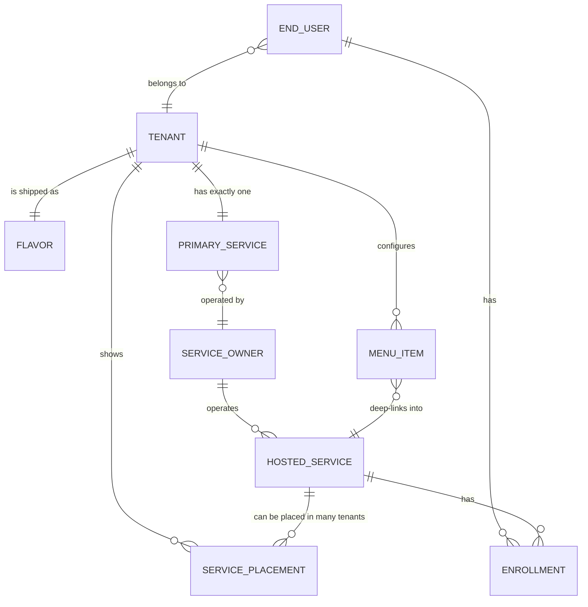
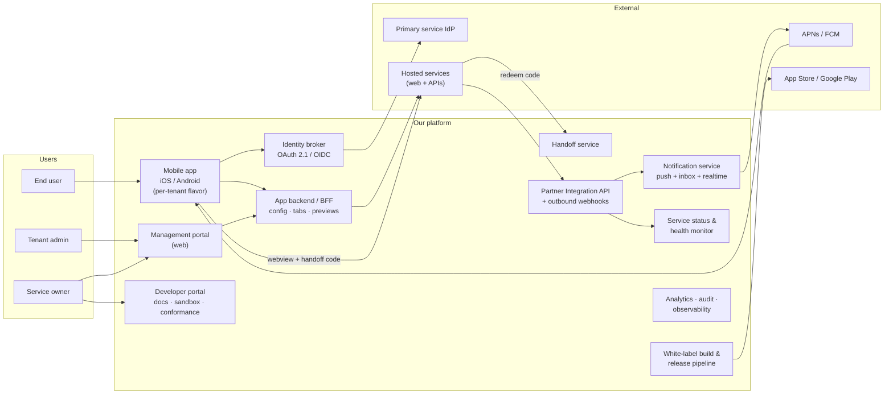

# Club Super-App — Business Requirements

> Status: **Draft v0.1** · Owner: TBD · Last updated: 2026-11-02

This folder holds the business requirements for a white-label "super-app" that hosts several web services
behind one sign-in, plus the management portal and the platform services they both depend on.

## How these documents are organised

| Level | ID format | What it says | Where |
|---|---|---|---|
| Business requirement | `BR-xx` | *What* the business needs and *why*, with no solution detail | Summary table below |
| User story | `US-xx.y` | Who needs what, in one sentence | Drill-down files |
| Acceptance criteria | `AC-xx.y.z` | How we know it's done. Written as Given/When/Then, or a checklist for configuration | Drill-down files |
| Non-functional requirement | `NFR-xx` | Measurable quality targets (speed, security, accessibility…) | [04-non-functional.md](04-non-functional.md) |
| Decision / open question | `Q-xx`, `R-xx` | Anything still undecided, plus risks | [05-open-questions-and-risks.md](05-open-questions-and-risks.md) |

Drill-down files:

1. [01-mobile-app.md](01-mobile-app.md): the end-user iOS/Android app
2. [02-management-portal.md](02-management-portal.md): the web portal for tenant and service owners
3. [03-platform-and-integrations.md](03-platform-and-integrations.md): the backend, partner API, SDK, build pipeline
4. [04-non-functional.md](04-non-functional.md)
5. [05-open-questions-and-risks.md](05-open-questions-and-risks.md)

**Process rule:** write acceptance criteria in full only for items marked MVP. Leave the rest at story level until
they are pulled into a release. Every open question needs an owner and a due date.

---

## 1. Glossary (the shared vocabulary)

| Term | Meaning |
|---|---|
| **Platform** | Everything we build and run: mobile app codebase, management portal, backend, partner API |
| **Tenant** | One customer of ours. One tenant = one branded app in the stores = one "flavor" |
| **Flavor** | A tenant-specific build of the mobile app: bundle ID, name, icon, splash, store listing |
| **Primary service** | The tenant's anchor service. It owns user identity: the main OAuth 2.1 login goes through it |
| **Hosted service** | A web service shown as a tab in the app. It may be owned by the tenant or by a third-party partner |
| **Service owner** | The organisation operating a hosted service. Configures it in the portal and integrates with the partner API |
| **Enrollment** | The link between a user and a hosted service ("the user is registered to the service") |
| **Tab state** | What a service tab shows a given user: Zero, Enrolling, Setup-pending, Active (preview), Re-auth required, Unavailable… |
| **Preview card** | Native UI on the tab that shows a summary of the user's data from the service (e.g. wallet balance) |
| **Handoff** | The secure, one-time hand-over of the signed-in user from the app to the hosted website when it opens |
| **Web container** | The in-app webview that shows a hosted service, plus the native chrome around it |
| **Bridge / Web SDK** | A small JS library hosted services include to talk to the native app (go home, open another service, etc.) |

## 2. Domain model

Recommendation on "a primary app might have hosted apps as well": model it as **ownership**, not nesting.
A hosted service has an owner. When the owner is the same organisation as the primary service, it is "one of the primary's hosted apps".
This keeps one tab model and one integration contract. If you meant visual nesting (sub-tabs inside a tab), that is a different
feature; see `Q-01`.

Allowing **one hosted service to be placed in many tenants** (e.g. a wallet partner serving five clubs) lets us integrate a partner once and resell it many times.
This is a strong business lever, and it is far cheaper to design in now than to retrofit later.

## 3. System context: what has to exist

The **mobile app** and the **portal** are the visible products. The parts you asked about ("features needed outside the 2 apps") are these:

| # | Component | Why it's needed |
|---|---|---|
| 1 | **App backend (BFF)** | The app should never call hosted services directly or hold their tokens. The BFF builds the tab list, fetches previews and applies config |
| 2 | **Identity broker** | Runs the main OAuth 2.1 login against the primary IdP and issues platform sessions. It also acts as an OIDC provider to hosted services |
| 3 | **Handoff service** | Issues and redeems one-time codes so a user who opens a service is already signed in there |
| 4 | **Partner Integration API** | Inbound for services: send notifications, report status, report setup completion, push preview updates |
| 5 | **Outbound webhooks** | Outbound to services: user enrolled, unlinked, deleted, logged out |
| 6 | **Notification service** | Push (APNs/FCM), the in-app inbox, real-time delivery, user preferences, badges |
| 7 | **Status & health monitor** | Combines what services *declare* (maintenance, outage) with what we *detect* (failing previews, health checks) |
| 8 | **Web SDK / JS bridge** | A versioned JS library services embed: go home, open another service, close, share, session expiry |
| 9 | **Developer portal + sandbox** | Docs, test tenant, test users, a conformance checker. Lets partners integrate without our engineers |
| 10 | **White-label build pipeline** | Builds, signs and submits one flavor per tenant from config. This is the "duplicate the app for a new customer" step |
| 11 | **Analytics, audit, observability** | Product analytics for tenants and service owners, an audit log for the portal, ops monitoring |

---

## 4. Business requirements summary

Priority: **M** = MVP, **N** = next release, **L** = later.

### Mobile app (end users): see [01-mobile-app.md](01-mobile-app.md)

| ID | Business requirement | Pri |
|---|---|---|
| BR-01 | Each tenant gets its own branded app in the stores without code changes (flavoring) | M |
| BR-02 | Users sign in once, through the tenant's primary service, using OAuth 2.1 | M |
| BR-03 | Users see all of the tenant's services in one swipeable, tabbed home | M |
| BR-04 | Each service tab reflects the user's relationship with that service (zero / setup / active / unavailable…) | M |
| BR-05 | Users can enroll in a service from inside the app with minimal friction | M |
| BR-06 | Enrolled users see a live preview of their data in each service without opening it | M |
| BR-07 | Users can open a service and arrive already signed in, inside the app | M |
| BR-08 | Users can navigate across services from a configurable side menu and always get back home in one tap | M |
| BR-09 | Users receive push and in-app notifications from any service, and control them | M |
| BR-10 | Users can manage their profile, consents, linked services, logout and account deletion | M |
| BR-11 | The app feels fun, fast and smooth enough that users choose to stay in it | M |

### Management portal (tenant and service owners): see [02-management-portal.md](02-management-portal.md)

| ID | Business requirement | Pri |
|---|---|---|
| BR-20 | Platform, tenant and service owners each manage only what they're entitled to (multi-tenant RBAC) | M |
| BR-21 | Tenant admins control their app's branding and global settings | M |
| BR-22 | Service owners configure everything about their tab: content, enrollment, setup, preview, launch, status | M |
| BR-23 | Tenant admins arrange which services appear, in what order, and build the side menu | M |
| BR-24 | Configuration changes can be drafted, previewed on a device and published safely, with rollback | M |
| BR-25 | Owners can declare maintenance and outages and see the health of their service | M |
| BR-26 | Tenant admins can send notifications (broadcasts) and manage templates | N |
| BR-27 | Owners see adoption and engagement analytics; every portal change is audited | N |
| BR-28 | Partners can self-onboard: credentials, sandbox, docs, go-live checklist | N |

### Platform and integrations: see [03-platform-and-integrations.md](03-platform-and-integrations.md)

| ID | Business requirement | Pri |
|---|---|---|
| BR-40 | A published, versioned integration contract lets any service plug in without custom code on our side | M |
| BR-41 | Identity is brokered securely; hosted services never receive the user's primary credentials | M |
| BR-42 | Services can push notifications, status and setup-completion events to us in real time | M |
| BR-43 | We notify services of lifecycle events (enrollment, unlink, logout, account deletion) | M |
| BR-44 | Hosted web apps can integrate with native app behaviour through a safe, versioned bridge | M |
| BR-45 | A new tenant can go from signed contract to store submission in days, not weeks | N |
| BR-46 | The platform is observable and supportable: tracing per user/service, support lookup tools | M |

---

## 5. Suggested MVP cut

The goal is to prove the riskiest assumptions with one tenant, one primary service and two hosted services, one of which is a third party:

1. Login with the primary (BR-02), tabbed home (BR-03), all tab states (BR-04)
2. **One** enrollment mode end-to-end (federated SSO; see BR-05), plus the preview card (BR-06), handoff and the web container (BR-07)
3. Side menu and home button (BR-08), push plus a basic inbox (BR-09), profile/logout/delete account (BR-10)
4. Portal: RBAC, service configuration, menu builder, draft→publish (BR-20 to BR-24), maintenance toggle (BR-25)
5. Partner API v1: notify, status, setup-complete. Webhooks v1: unlink/delete/logout. Web SDK v1
6. Flavoring done by a *manual but scripted* pipeline. Full automation (BR-45) comes next
